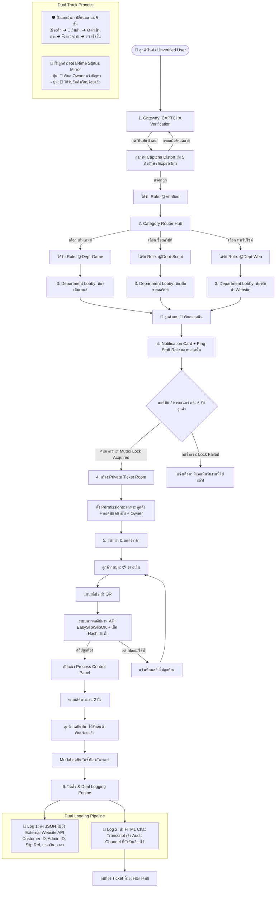

# 🏛️ SYSTEM ARCHITECTURE SPECIFICATION
## Project: PAYOMBØYZ Work-Allocation & Dispatch Ticket Engine (SC-Script-Bot)
**Target Platform:** Discord.py 2.x | Python 3.11+ / 3.12 | SQLite WAL Mode  
**Architecture Author:** PAYOMBØYZ Team  
**Scope:** Multi-department task routing, single-admin claim concurrency, captcha gatekeeper, slip verification API, 5-stage order progression, and dual logging.

---

## 1. High-Level System Overview & Flowchart



---

## 2. Concurrency & Anti-Race Condition Algorithm (Single Admin Claim Mutex)

### ปัญหาที่ต้องแก้ไข (Race Condition):
เมื่อมีลูกค้ากดเรียกแอดมิน อาจมีแอดมินหรือพาร์ทเนอร์ 2 คนขึ้นไปกดปุ่ม `[ ⚡ รับลูกค้า ]` ในเวลาเสี้ยววินาทีเดียวกัน หากไม่มีกลไก Concurrency Guard บอทจะเปิดห้องตั๋วซ้ำ 2 ห้อง หรือดึงแอดมินทั้ง 2 คนเข้ามาพร้อมกัน ทำให้เกิดความสับสนและแย่งลูกค้า

### อัลกอริทึมแก้ปัญหา (Atomic Compare-And-Swap ใน SQLite):
ระบบใช้คำสั่ง SQL Atomic Update ด้วย Conditional State Check ร่วมกับ `asyncio.Lock` ระดับ In-Memory:

```python
# Pseudo-code / Algorithm Implementation:
async def claim_customer_call(call_id: str, admin_id: int) -> bool:
    async with db_lock:
        # Atomic Update: จะอัปเดตสำเร็จก็ต่อเมื่อสถานะปัจจุบันยังคงเป็น 'waiting' เท่านั้น
        cursor = await db.execute("""
            UPDATE pending_calls 
            SET status = 'claimed', 
                claimed_by = ?, 
                claimed_at = ? 
            WHERE call_id = ? AND status = 'waiting'
        """, (str(admin_id), time.time(), call_id))
        
        await db.commit()
        
        # ถ้ายอดแถวที่ถูกแก้ = 1 แสดงว่าแอดมินคนนี้คือคนแรกที่คว้า Lock ได้
        if cursor.rowcount == 1:
            return True
        # ถ้า = 0 แสดงว่ามีแอดมินท่านอื่นชิงกดไปก่อนแล้ว
        return False
```

**ผลลัพธ์:**
- คนแรก: ได้รับผล `True` -> บอทสร้างห้อง Ticket และเชิญเฉพาะแอดมินท่านนี้
- คนถัดไป: ได้รับผล `False` -> บอทแสดง Ephemeral message: `⚠️ งานนี้ถูกรับไปแล้วโดยแอดมินท่านอื่น!` และเปลี่ยนปุ่มเป็นการ์ดสีเทา (Disabled)

---

## 3. Dynamic Captcha Engine Architecture

### ข้อกำหนดด้านความปลอดภัย (Anti-Bypass & Anti-OCR):
1. **No External Assets Required:** เจนเนอเรตแบบ Procedural บนแรมด้วย `Pillow (PIL)` โดยใช้ฟอนต์มาตรฐานหรือ Vector Drawing
2. **Visual Noise & Distortion Matrix:**
   - Background Color: `#0A0D14` (Dark Space Theme)
   - Foreground Text: สีฟ้าสว่าง `#4AE0FF` ถึงสีขาว `#FFFFFF`
   - Noise Dots: จุดสุ่ม 80-120 จุดกระจายทั่วภาพ
   - Interference Lines: เส้นคลื่นสับสน 4-6 เส้น พาดผ่านตัวอักษรเพื่อตัด Edge Detection ของ OCR
   - Text Jitter: หมุนองศาตัวอักษรทีละตัว (-15° ถึง +15°)
3. **Session Replay Guard:**
   - โค้ดแต่ละชุดมีอายุการใช้งาน 300 วินาที (5 นาที)
   - โค้ดจะถูกผูกกับ `user_id` และ `session_id` เมื่อยืนยันเสร็จหรือหมดอายุจะถูกทำลายทิ้งทันที
   - ไม่สามารถนำภาพเดิมมาส่งซ้ำได้

---

## 4. Slip Verification API & Anti-Replay Architecture

```
[ สลิปภาพ / QR Payload ] 
          │
          ▼
   [ CRC32 / SHA-256 Hash ]
          │
          ├──► ตรวจสอบใน `slip_ledger` (SQLite)
          │    └──► หากพบ Hash เดิม ──► REJECT: "สลิปนี้ถูกใช้งานไปแล้ว"
          │
          └──► หากเป็นสลิปใหม่ ──► ยิงตรวจเช็คกับ API ภายนอก (EasySlip / SlipOK / Custom)
               ├──► ตรวจสอบชื่อบัญชีผู้รับเงิน (Receiver Account Match)
               ├──► ตรวจสอบยอดเงินขั้นต่ำ (Amount >= Minimum Threshold)
               └──► ตรวจสอบวันที่ทำรายการ (Transaction Timestamp <= 24 ชม.)
                    │
                    ▼
               บันทึกลง `slip_ledger` ทันที ──► ปลดล็อกสถานะ "ชำระเงินสำเร็จ"
```

---

## 5. Dual-Logging Pipeline Specification

### Log 1: REST API / Webhook Payload (External Website)
ส่งข้อมูลผ่าน `aiohttp` เป็น JSON Payload:
```json
{
  "event_type": "TICKET_COMPLETED",
  "ticket_metadata": {
    "ticket_id": 108,
    "channel_id": "1549803866134941767",
    "category": "game_topup",
    "opened_at": 1729738000,
    "closed_at": 1729742400
  },
  "customer": {
    "discord_id": "1549398019970179152",
    "username": "PayomCustomer"
  },
  "admin": {
    "discord_id": "1549535328753164418",
    "username": "PayomAdmin"
  },
  "transaction": {
    "amount": 490.00,
    "slip_ref": "2026102402348912",
    "verified_at": 1729739500
  }
}
```

### Log 2: Audit HTML Chat Transcript
- บังคับเลือก Channel ตั้งแต่ตอนรันคำสั่ง `/setup_dispatch`
- บันทึกข้อความทุกข้อความ, Embed, เวลา (Timestamps), รูปโปรไฟล์ผู้ส่ง, และไฟล์แนบ
- แปลงเป็นเอกสาร Standalone HTML5 Dark Theme
- ส่งเข้า Log Channel พร้อม Embed สรุปสาระสำคัญ เพื่อให้ Owner ตรวจสอบย้อนหลังได้ทุกเมื่อ
